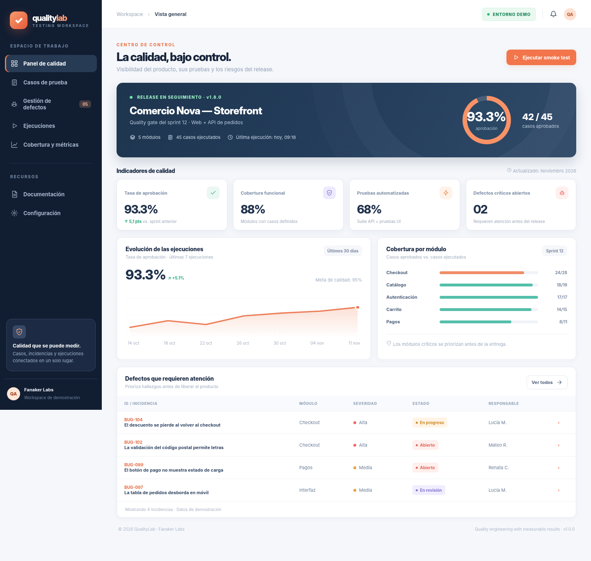
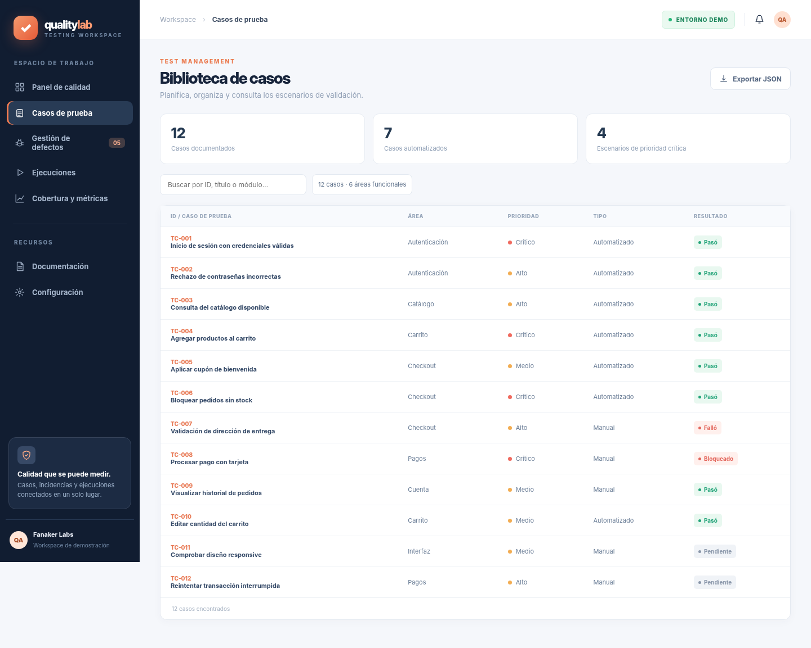
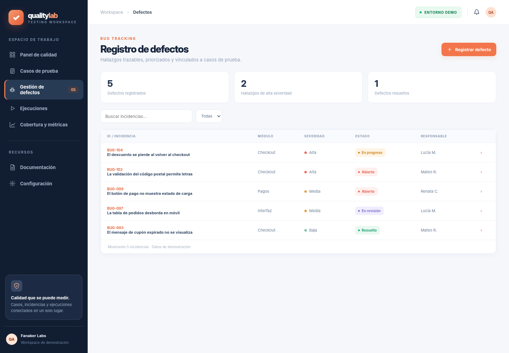
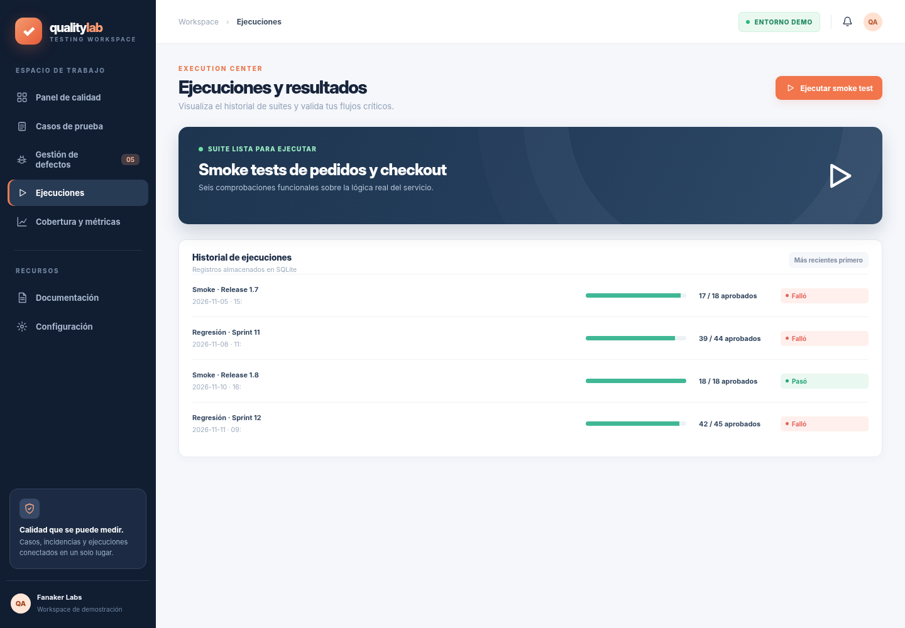
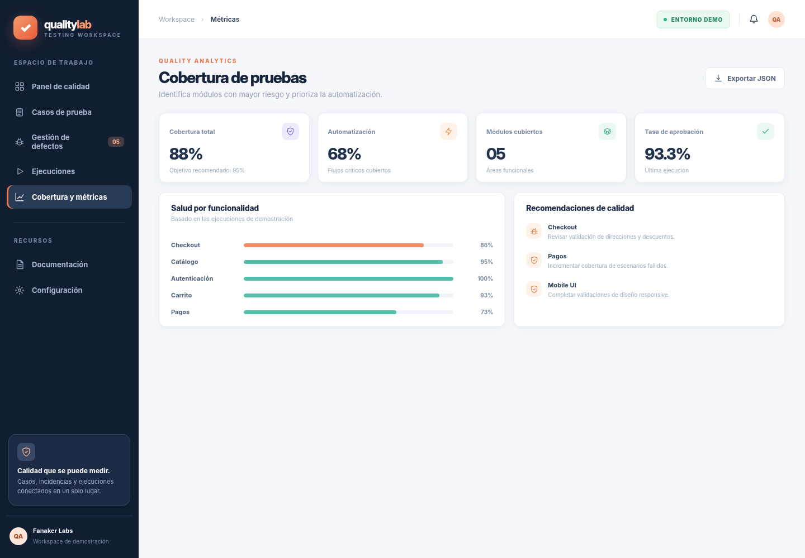
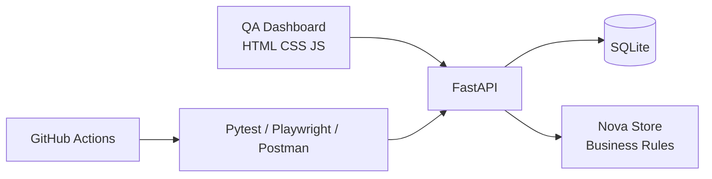

# QualityLab · QA Command Center

**Quality Assurance · Software Testing · Automatización**

Sistema de gestión de calidad para una tienda digital ficticia, con dashboard, biblioteca de casos, gestión de defectos, ejecuciones reproducibles y una pequeña **API de comercio que sirve como sistema bajo prueba (SUT)**. La aplicación se ejecuta en local, sin cuentas ni servicios externos.

**Tecnologías:** Python · FastAPI · Pytest · Playwright · SQLite · REST API · JavaScript · Postman · GitHub Actions



## Funcionalidades principales

- **Centro de calidad:** tasas de aprobación, cobertura ilustrativa, defectos priorizados y tendencia de ejecuciones de demostración.
- **Test case management:** casos con ID, área, prioridad, tipo y resultado.
- **Bug tracking:** registro de incidencias, consulta y cambio de estado; persistencia en SQLite.
- **Smoke suite ejecutable:** seis verificaciones sobre las reglas del SUT, con resultado persistente.
- **Testing reproducible:** Pytest para API, Playwright para la interfaz y colección Postman opcional.
- **Automatización:** workflow de GitHub Actions para pruebas y validaciones de JavaScript.

## Interfaz

| Casos de prueba | Defectos |
|---|---|
|  |  |

| Ejecuciones | Cobertura |
|---|---|
|  |  |

Estas capturas se renderizaron a partir de la **interfaz web incluida en el repositorio**, usando el payload de demostración de la API. Las estadísticas históricas del sprint y algunos defectos son **datos ficticios**, no resultados de un producto comercial auditado.

## Ejecución local

Requisitos: Python **3.11+**. Comandos desde la raíz del repositorio:

```bash
python -m venv .venv
# Windows (PowerShell): .\.venv\Scripts\Activate.ps1
# macOS/Linux: source .venv/bin/activate
pip install -r requirements.txt
uvicorn app.main:app --reload
```

Abrir **http://127.0.0.1:8000**. Documentación interactiva de API: **http://127.0.0.1:8000/docs**.

Ejecutar tests:

```bash
python -m pytest -q tests/test_api.py
python -m playwright install chromium  # solo la primera vez
python -m pytest -q tests/test_browser.py
```

La prueba de navegador puede usar Chromium del sistema si está disponible. El navegador es una dependencia opcional solo para la prueba UI; la aplicación funciona sin él.

## Endpoints representativos

| Método | Ruta | Uso |
|---|---|---|
| GET | `/api/overview` | Dashboard, casos y defectos de prueba |
| GET | `/api/shop/products` | Catálogo del sistema bajo prueba |
| POST | `/api/shop/quote` | Cotización de pedido con validaciones |
| POST | `/api/runs` | Ejecutar las seis pruebas smoke |
| POST | `/api/defects` | Registrar incidencia |
| PATCH | `/api/defects/{id}?status=Resuelto` | Cambiar estado |
| GET | `/health` | Estado de la API |

## Arquitectura



Estructura relevante:

```text
QualityLab/
├── app/           # API, persistencia y reglas de negocio SUT
├── web/           # Interfaz responsive
├── tests/         # API + UI smoke tests
├── postman/       # Colección para probar endpoints
├── docs/          # Test plan + screenshots
├── .github/       # CI automatizado
└── requirements.txt
```

La base SQLite se crea automáticamente en `data/` al primer arranque (configurable con `QUALITYLAB_DB`).

## Decisiones y alcance

Este proyecto prioriza **pruebas que sí se pueden ejecutar**, documentación de hallazgos y trazabilidad. No intenta ser un clon de Jira/TestRail. El dashboard presenta **datos de laboratorio identificados**, mientras que las pruebas efectivamente implementadas viven en `tests/` y en la suite smoke de FastAPI.

Más información: [plan de pruebas](docs/TEST_PLAN.md) y [estado verificado](PROJECT_STATUS.md).

---

## Autor y licencia

**Fanaker Labs** · Proyecto personal de aseguramiento de calidad, pruebas automatizadas y gestión de defectos. Código bajo licencia [MIT](LICENSE).
